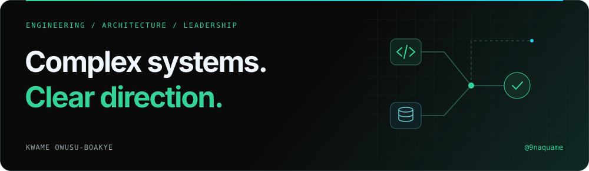
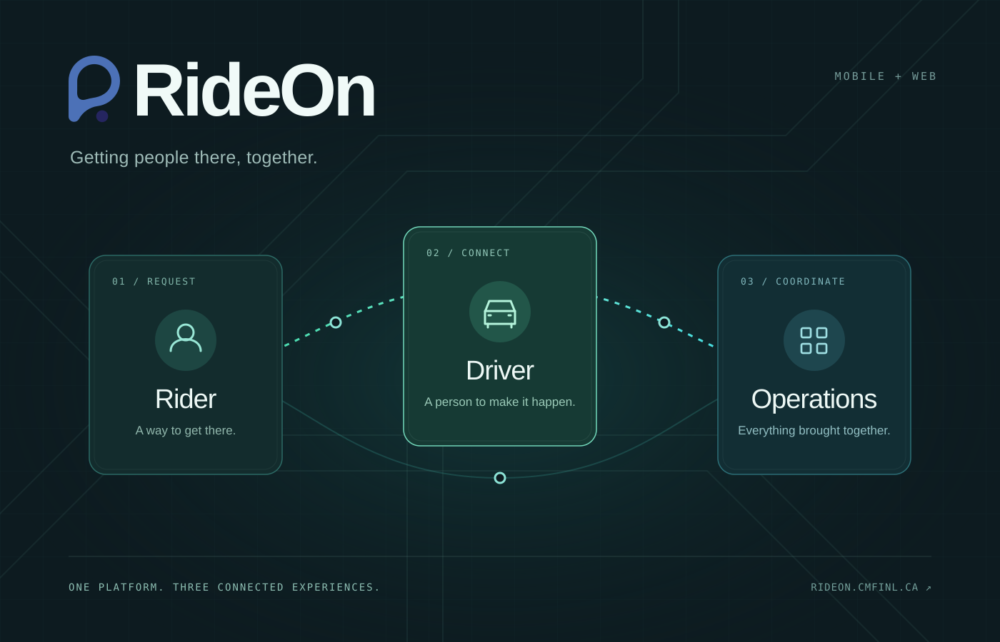
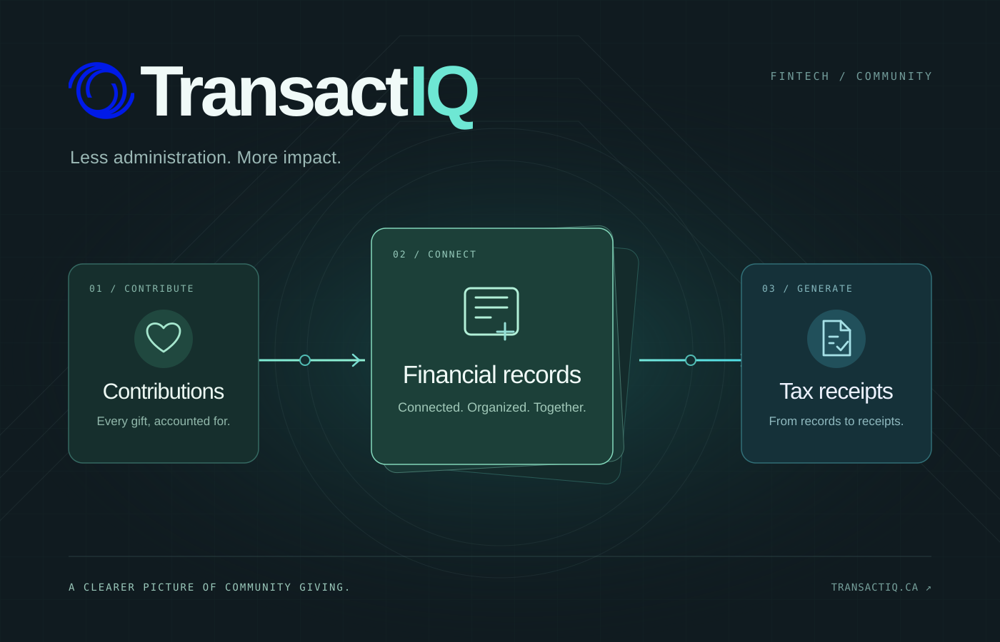

# Hi there 👋 I’m Kwame.

**I build the systems behind the screens.** APIs, data pipelines, cloud platforms — and teams that make them work.

Engineering leader at **[Nasdaq Verafin](https://verafin.com/)**. 
📍 Newfoundland & Labrador, Canada · 🛠️ Hands-on since 2012

[Explore my corner of the internet ↗](https://9naqua.me) · [LinkedIn](https://www.linkedin.com/in/9naquame/) · [Say hello](mailto:kwame@owusuboakye.com)

### A little less talk. A little more build. ⚡

<table>
<tr>
<td width="50%" valign="top">

**[RideOn ↗](https://9naqua.me/work/rideon)** 
Getting people there, together. Community transportation across rider, driver, and admin apps.

Flutter · FastAPI · PostgreSQL

</td>
<td width="50%" valign="top">

**[TransactIQ ↗](https://9naqua.me/work/transactiq)** 
Less administration. More impact. Contributions and tax receipts for churches and charities.

React · FastAPI · PostgreSQL

</td>
</tr>
</table>

### Usually in the mix 🧩

`Python` · `Scala` · `Java` · `TypeScript` · `AWS` · `Next.js` · `Astro` · `Flutter`

- 🔧 **The interesting problems:** distributed data, clean boundaries, and getting all the moving parts to agree.
- 🌱 **The people side:** mentoring developers, teaching through Digital Makers Lab, and facilitating Community Build Lab.
- 💬 **An easy conversation starter:** something you’re building, something that’s broken, or an idea you can’t leave alone.

---

**Still curious. Still building.** [Come say hi →](mailto:kwame@owusuboakye.com)
